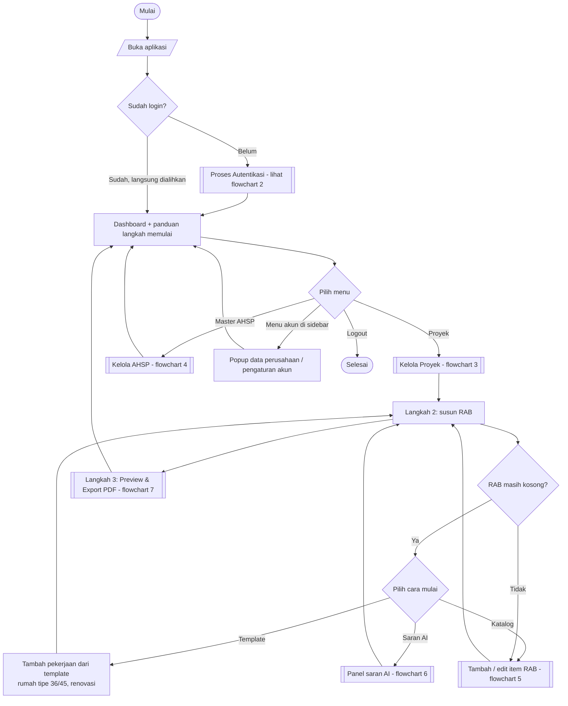
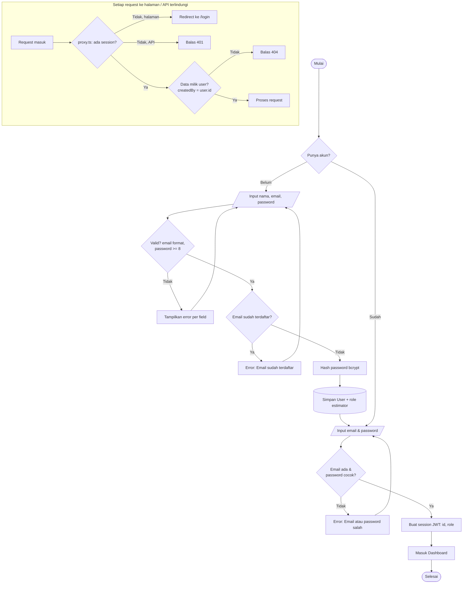
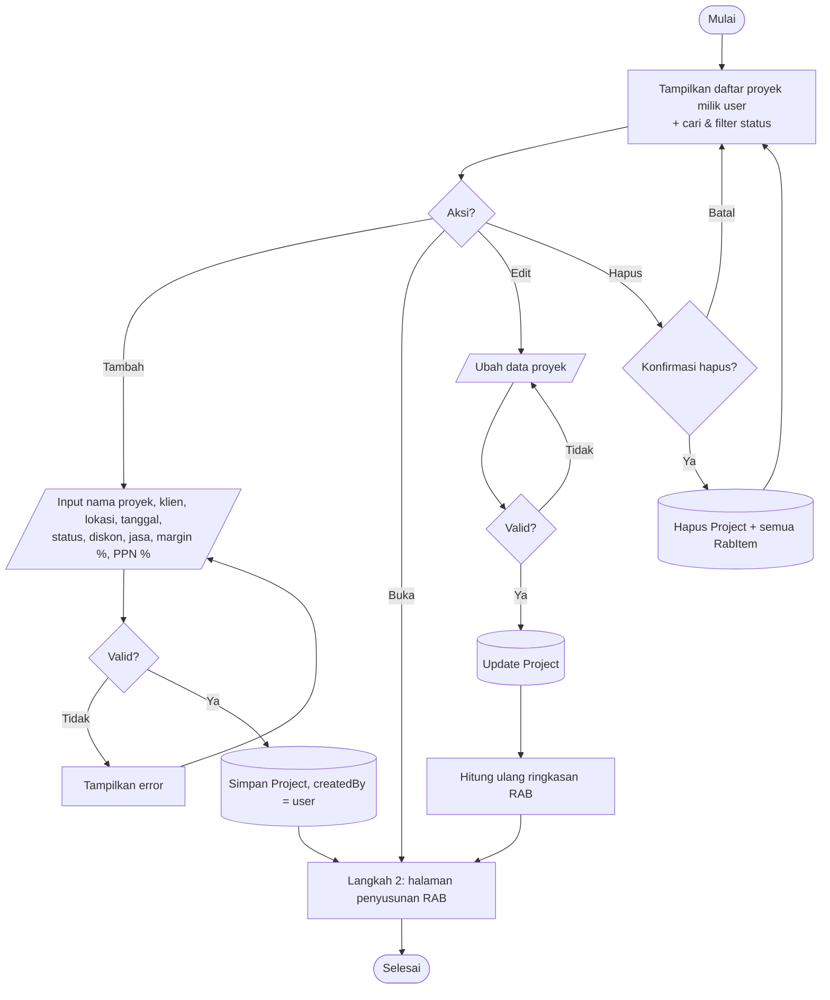
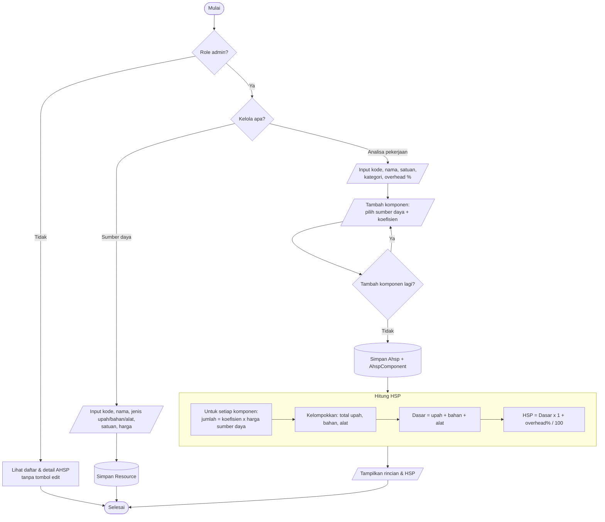
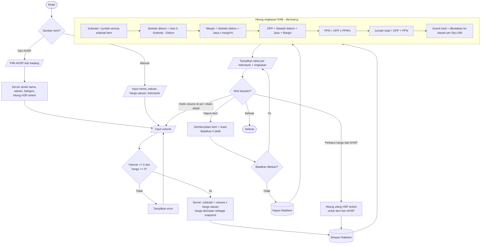
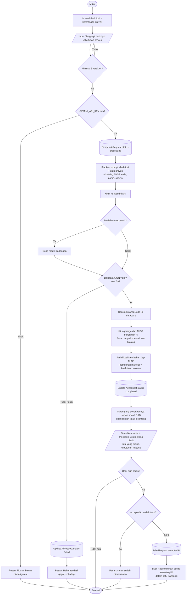
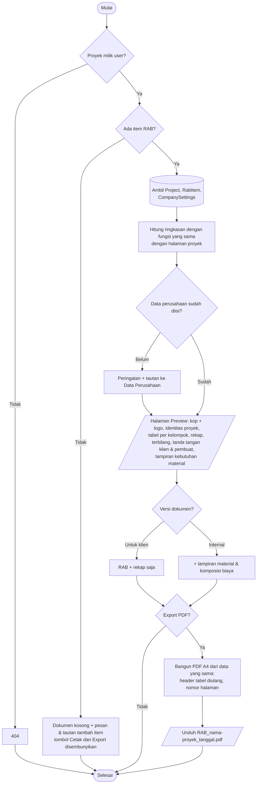
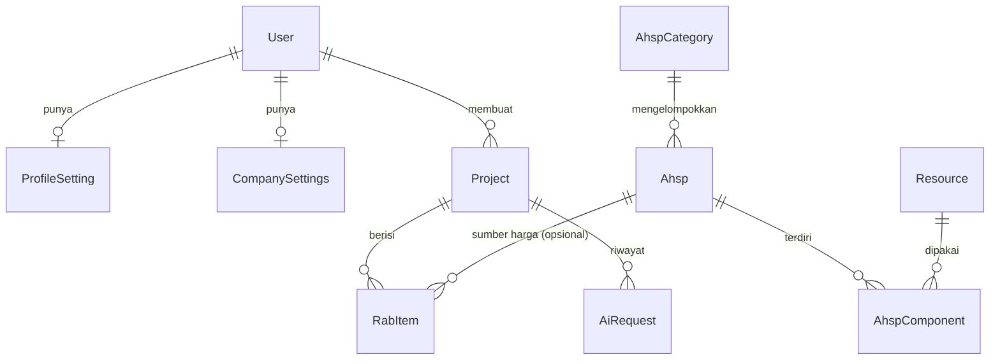

# Flowchart: Sistem RAB Kontraktor

Versi 2.3, 25 November 2026 (v2.0: 20 November 2026). Mengikuti `docs/PRD.md` v2.0. Versi lama ada di `docs/_old/FLOWCHART-v1.md`.

Sintaks Mermaid. Bisa dirender di VS Code (extension "Markdown Preview Mermaid Support"), GitHub, atau https://mermaid.live.

Simbol: `([ ])` = mulai/selesai, `[ ]` = proses, `{ }` = keputusan, `[/ /]` = input/output, `[( )]` = database.

---

## 1. Alur Utama Sistem

Setiap proyek dikerjakan dalam tiga langkah yang selalu terlihat di atas halaman: **1. Data proyek → 2. Susun RAB → 3. Preview & PDF**. Langkah 3 baru bisa dibuka setelah RAB berisi minimal satu item.

## 2. Autentikasi (Register, Login, Proteksi Halaman)

## 3. Kelola Proyek (UKK #1)

## 4. Kelola Master AHSP & Hitung Harga Satuan Pekerjaan (UKK #2)

Contoh: Pekerja 0,75 OH × 120.000 = 90.000; Mandor 0,025 OH × 180.000 = 4.500. Dasar 94.500, overhead 10%, maka **HSP = 103.950 / m³**.

## 5. Tambah Item RAB & Hitung Total RAB (UKK #2 & #4)

## 6. Rekomendasi AI (UKK #3)

## 7. Preview & Export PDF (UKK #5)

## 8. Relasi Data (ERD ringkas)

