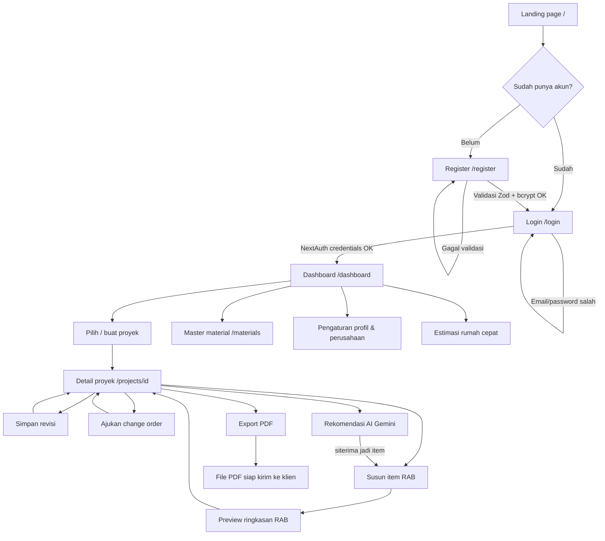
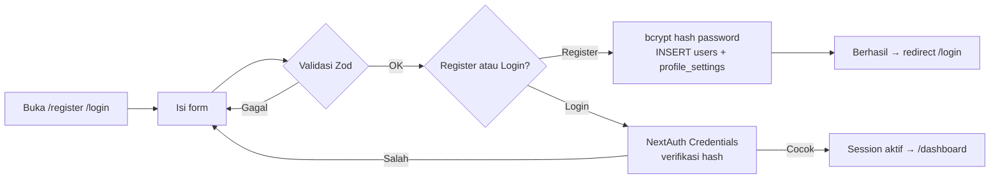
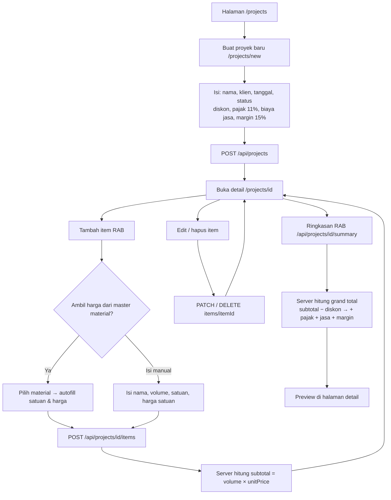
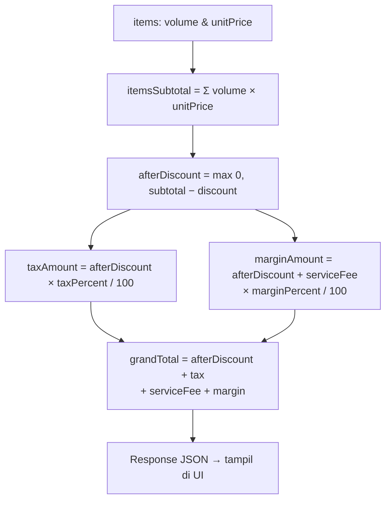
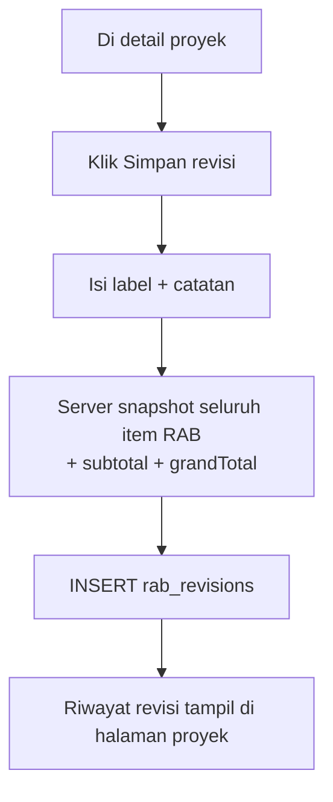
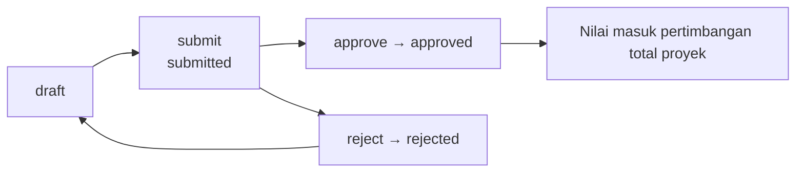
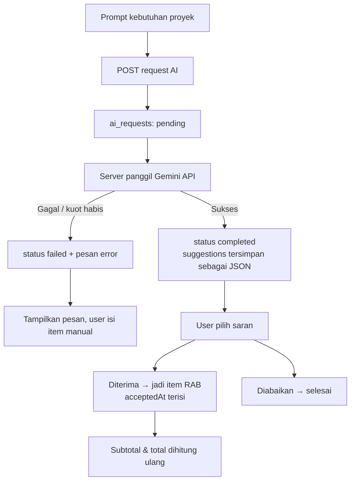
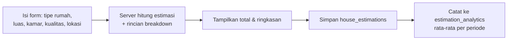
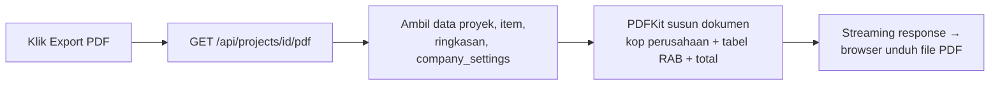
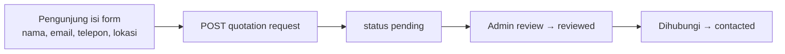

# Flowchart — RABKita

Dokumen ini memakai sintaks Mermaid. Render otomatis di GitHub, VS Code (extension Mermaid), atau tempel ke `mermaid.live`.

---

## 1. Alur Utama Aplikasi (High Level)



## 2. Autentikasi



## 3. Alur Proyek & Item RAB



## 4. Perhitungan Ringkasan RAB (Server-Side)



## 5. Revisi RAB



## 6. Change Order



## 7. Rekomendasi AI (Gemini)



## 8. Master Material

```mermaid
flowchart TD
    A[/materials] --> B[Tambah material]
    A --> C[Edit / hapus material]
    B --> D[POST /api/materials<br/>scoped ke ownerId = user login]
    C --> E[PATCH / DELETE api/materials/id]
    D --> F[Tersimpan, muncul di daftar]
    E --> F
    F --> G[Saat item RAB dibuat,<br/>material jadi sumber harga satuan]
```

## 9. Estimasi Rumah Cepat



## 10. Export PDF



## 11. Permintaan Penawaran (Landing Page)


