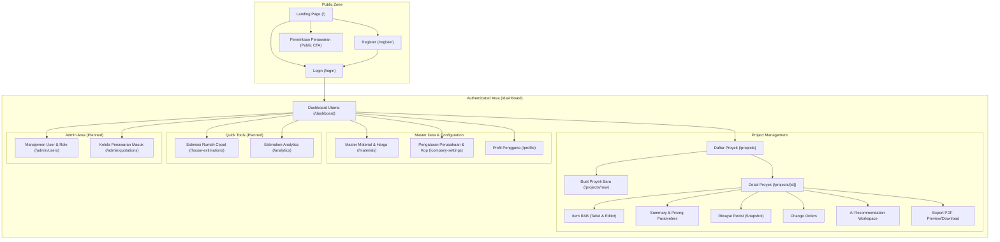
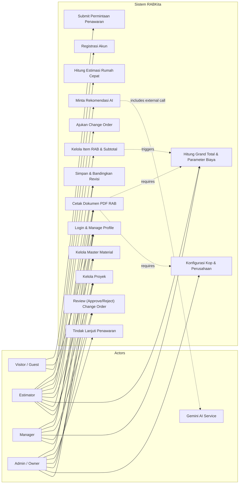
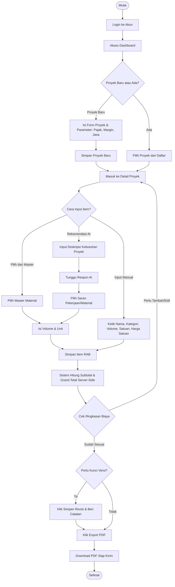
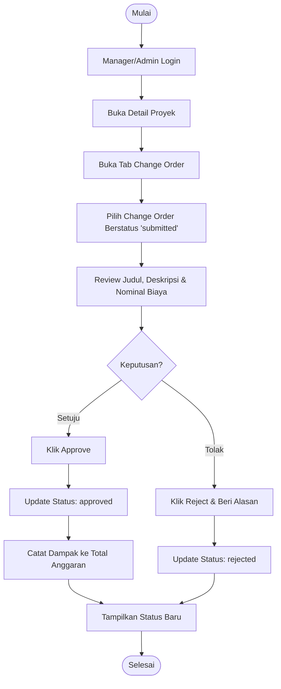
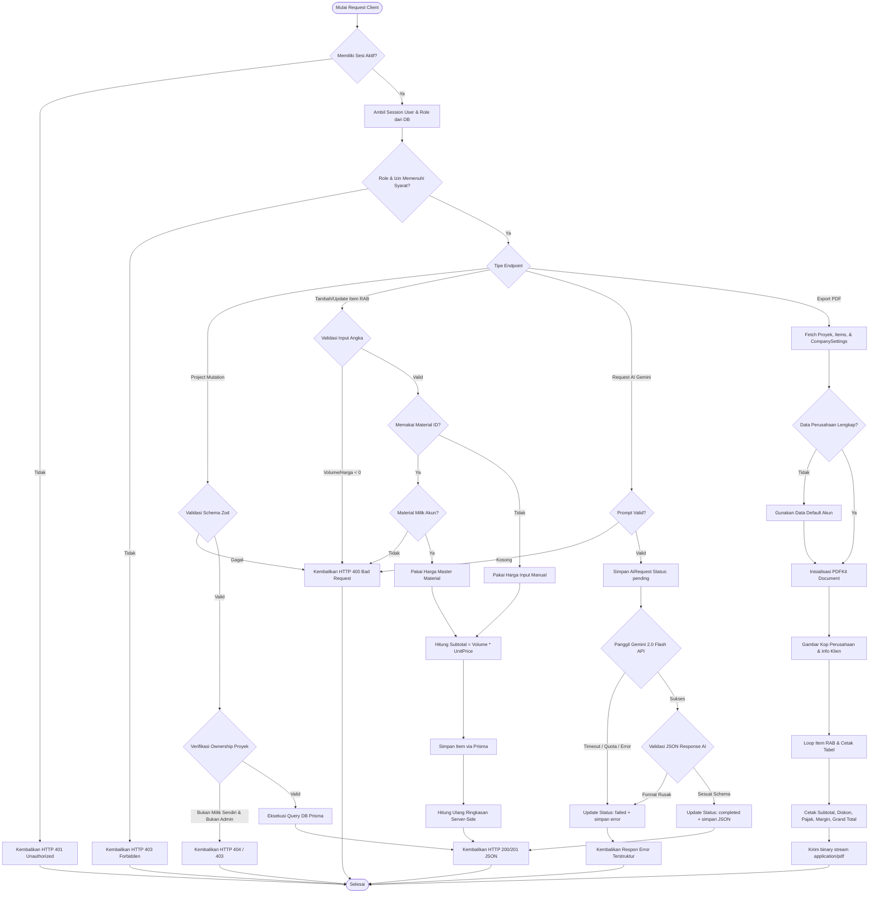
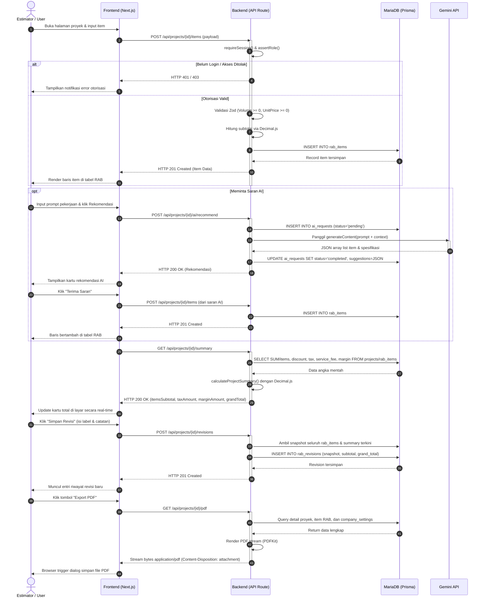
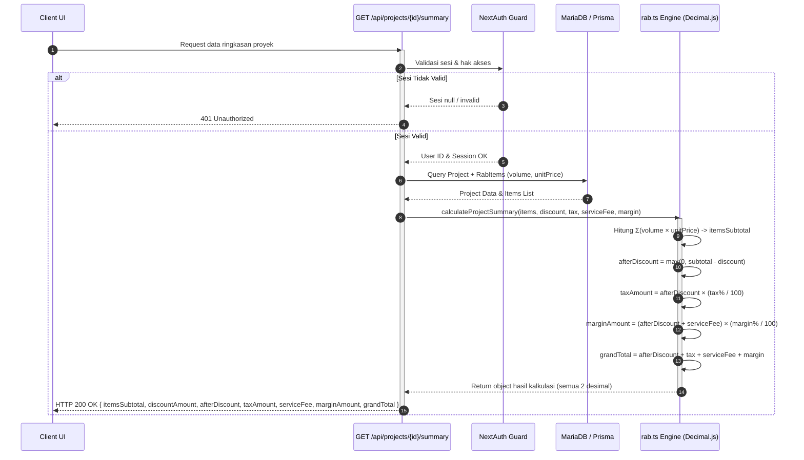

# System Architecture & Modeling Diagrams — RABKita

Semua diagram menggunakan Mermaid syntax.

---

## 1. Information Architecture & Sitemap



---

## 2. Use Case Diagram



---

## 3. User Flow Diagrams

### 3.1 Alur Inti: Estimator Menyusun RAB



### 3.2 Alur Persetujuan Change Order (Manager)



---

## 4. System Flowchart (End-to-End Business Logic & Exceptions)



---

## 5. Activity Diagram with Swimlanes (Penyusunan & Pengesahan RAB)



---

## 6. Entity Relationship Diagram (ERD)

```mermaid
erDiagram
    User ||--o| ProfileSetting : "has profile"
    User ||--o| CompanySettings : "owns company info"
    User ||--o{ Project : "creates"
    User ||--o{ Material : "manages"
    User ||--o{ AiRequest : "initiates"
    User ||--o{ RabRevision : "creates revision"
    User ||--o{ ChangeOrder : "submits/approves"
    User ||--o{ HouseEstimation : "runs"
    User ||--o{ EstimationAnalytic : "tracks"

    Project ||--o{ RabItem : "contains"
    Project ||--o{ RabRevision : "has history"
    Project ||--o{ ChangeOrder : "tracks changes"
    Project ||--o{ AiRequest : "context for"
    
    Material ||--o{ RabItem : "referenced by"

    User {
        bigint id PK
        varchar name
        varchar email UK
        datetime email_verified_at
        varchar password
        datetime created_at
        datetime updated_at
    }

    ProfileSetting {
        bigint id PK
        bigint user_id FK,UK
        UserRole role "admin | estimator | manager | client"
        varchar phone_number
        varchar department
        text notes
        datetime created_at
        datetime updated_at
    }

    CompanySettings {
        bigint id PK
        bigint owner_id FK,UK
        varchar company_name
        text address
        varchar phone
        varchar email
        varchar logo_url
        datetime created_at
        datetime updated_at
    }

    Project {
        bigint id PK
        bigint created_by FK
        varchar project_name
        varchar client_name
        text description
        date start_date
        date end_date
        ProjectStatus status "planning | progress | completed | cancelled"
        decimal rab_discount
        decimal rab_tax_percent
        decimal rab_service_fee
        decimal target_margin_percent
        datetime created_at
        datetime updated_at
    }

    RabItem {
        bigint id PK
        bigint project_id FK
        bigint material_id FK "nullable, set null on delete"
        varchar group_name
        varchar name
        varchar category
        decimal volume
        varchar unit
        decimal unit_price
        decimal subtotal
        datetime created_at
        datetime updated_at
    }

    Material {
        bigint id PK
        bigint owner_id FK
        varchar name
        varchar category
        varchar unit
        decimal unit_price
        varchar supplier
        text description
        datetime created_at
        datetime updated_at
    }

    RabRevision {
        bigint id PK
        bigint project_id FK
        bigint user_id FK
        varchar label
        text notes
        json snapshot "Full frozen array of items & summary"
        decimal subtotal
        decimal grand_total
        datetime created_at
        datetime updated_at
    }

    ChangeOrder {
        bigint id PK
        bigint project_id FK
        bigint user_id FK
        varchar title
        text description
        decimal amount
        ChangeOrderStatus status "draft | submitted | approved | rejected"
        date requested_at
        datetime created_at
        datetime updated_at
    }

    AiRequest {
        bigint id PK
        bigint project_id FK
        bigint user_id FK
        text prompt
        AiRequestStatus status "pending | processing | completed | failed"
        json suggestions
        text error
        datetime accepted_at
        datetime created_at
        datetime updated_at
    }

    HouseEstimation {
        bigint id PK
        bigint user_id FK "nullable"
        varchar title
        varchar house_type
        decimal floor_area
        decimal land_area
        int bedrooms
        int bathrooms
        HouseEstimationQuality quality "hemat | standar | premium"
        varchar location
        text notes
        json additional_features
        decimal total_estimate
        json breakdown
        text summary
        HouseEstimationStatus status "pending | completed | archived"
        datetime created_at
        datetime updated_at
    }

    EstimationAnalytic {
        bigint id PK
        bigint user_id FK "nullable"
        varchar metric_type
        json data
        int count
        decimal average
        varchar period
        datetime created_at
        datetime updated_at
    }

    QuotationRequest {
        bigint id PK
        varchar name
        varchar email
        varchar phone
        varchar location
        text message
        QuotationRequestStatus status "pending | reviewed | contacted"
        datetime created_at
        datetime updated_at
    }
```



---

## 7. Sequence Diagrams

### 7.1 Sequence Diagram: Kalkulasi Grand Total Server-Side



### 7.2 Sequence Diagram: Pembuatan Dokumen PDF dengan Kop Perusahaan

```mermaid
sequenceDiagram
    autonumber
    participant Client as User Browser
    participant PdfAPI as GET /api/projects/{id}/pdf
    participant Auth as NextAuth Guard
    participant DB as MariaDB / Prisma
    participant Engine as PDFKit Stream Engine

    Client->>PdfAPI: Unduh PDF RAB
    activate PdfAPI
    PdfAPI->>Auth: Cek autentikasi user
    Auth-->>PdfAPI: User OK

    PdfAPI->>DB: SELECT Project, RabItems, User (CompanySettings) WHERE id = {id}
    DB-->>PdfAPI: Project details, items list, company settings

    PdfAPI->>Engine: Inisialisasi PDFKit(margin: 40, size: A4)
    activate Engine
    
    opt Ada CompanySettings
        Engine->>Engine: Render Logo, Nama Perusahaan, Alamat, Kontak
    end
    
    Engine->>Engine: Render Garis Pemisah & Header Proyek (Nama, Klien, Tanggal)
    Engine->>Engine: Render Tabel Item RAB (No, Nama, Vol, Sat, Harga, Subtotal)
    Engine->>Engine: Render Box Rekapitulasi (Subtotal, Diskon, PPN 11%, Biaya Jasa, Margin, Total Akhir)
    Engine->>Engine: Render Kolom Tanda Tangan (Estimator & Klien)
    
    Engine-->>PdfAPI: Chunk buffer stream siap kirim
    deactivate Engine

    PdfAPI-->>Client: Headers: Content-Type: application/pdf, Content-Disposition: attachment; filename="RAB-{id}.pdf"
    deactivate PdfAPI
    Client->>Client: Unduh file PDF otomatis
```
